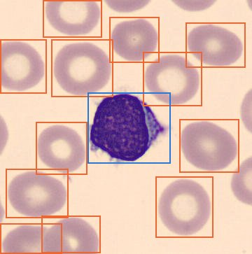
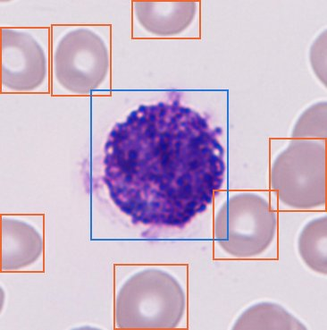
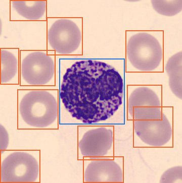
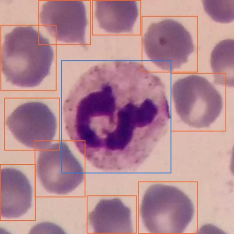
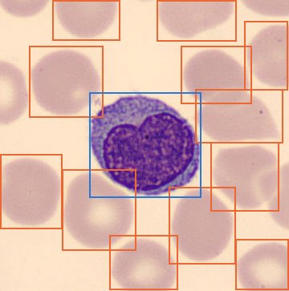
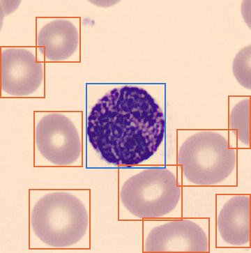

# Dataset report: TXL-PBC

Blood smear images annotated for detection of three cell types: WBC, RBC, Platelets.

## Splits and class counts

| Split | Images | Cells | WBC | RBC | Platelets |
|---|---:|---:|---:|---:|---:|
| train | 882 | 12510 | 908 | 11220 | 382 |
| val | 252 | 3752 | 257 | 3383 | 112 |
| test | 126 | 1881 | 133 | 1699 | 49 |
| **Total** | 1260 | 18143 | 1298 | 16302 | 543 |

The classes are heavily imbalanced: WBC 7.2%, RBC 89.9%, Platelets 3.0%. RBCs make up most of the cells, while
platelets are both rare and small, so platelet recall is the metric most likely to lag.

## Images

- Sizes: 575x575 (500), 360x363 (486), 640x480 (160), 256x256 (100), 366x369 (14)
- Color modes: RGB (1160), RGBA (100). RGBA images are read
  as 3-channel by the training loader.
- Cells per image: median 14, range
  4–32.

## Box sizes (square root of box area, in pixels)

| Class | Min | Median | Max |
|---|---:|---:|---:|
| WBC | 69.0 | 184.1 | 374.7 |
| RBC | 36.8 | 87.0 | 307.8 |
| Platelets | 16.0 | 33.5 | 109.5 |

Boxes are close to square for all classes (median aspect ratio ~1.0).

## Label quality

47 exact duplicate boxes were found (same class and coordinates
repeated within one label file). No missing label files, empty images or
out-of-range coordinates. Ultralytics removes duplicate labels when it caches the
dataset, so the source files were left unchanged.

## Annotated samples (training split)

Blue = WBC, orange = RBC, green = Platelets.

