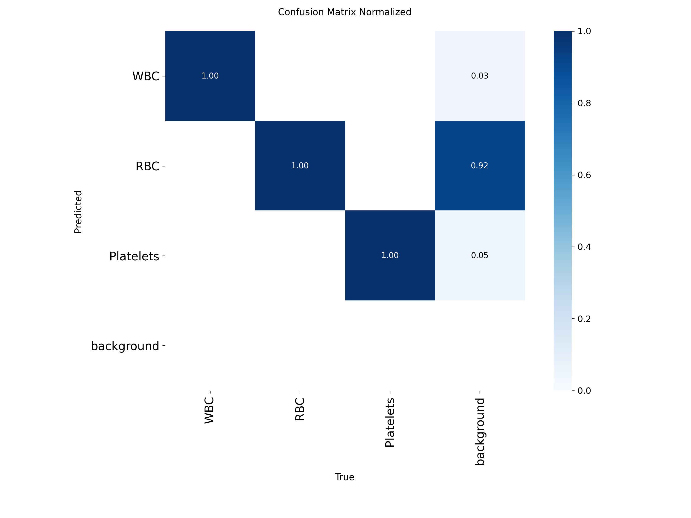
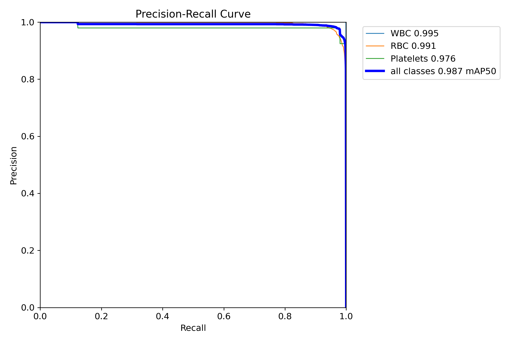
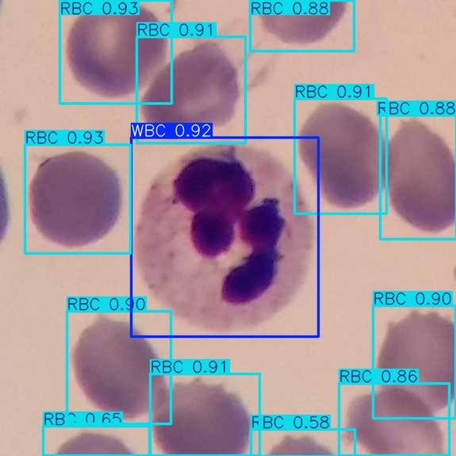
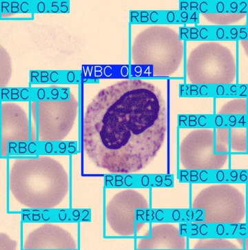
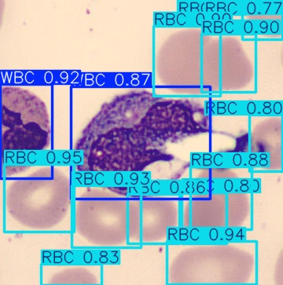
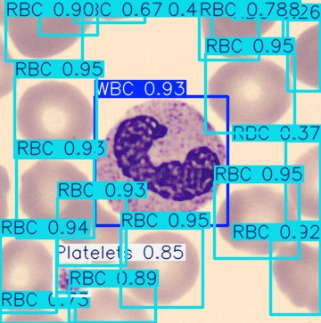
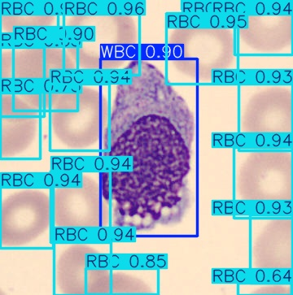
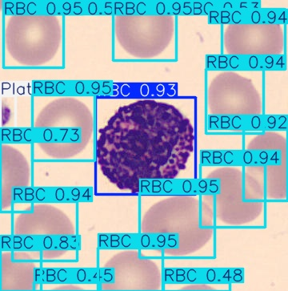
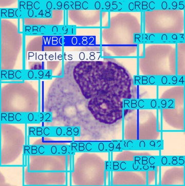
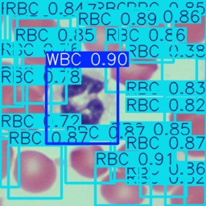

# Evaluation report

Model: best checkpoint from the training run, evaluated at image size
640. The test split (126 images) was never used
during training or model selection.

## Test split

| Class | Precision | Recall | mAP50 | mAP50-95 |
|---|---:|---:|---:|---:|
| WBC | 0.999 | 1.000 | 0.995 | 0.887 |
| RBC | 0.984 | 0.937 | 0.991 | 0.895 |
| Platelets | 0.963 | 0.980 | 0.976 | 0.806 |
| **All** | **0.982** | **0.972** | **0.987** | **0.863** |

## Validation split

| Class | Precision | Recall | mAP50 | mAP50-95 |
|---|---:|---:|---:|---:|
| WBC | 0.991 | 0.996 | 0.993 | 0.899 |
| RBC | 0.965 | 0.959 | 0.991 | 0.898 |
| Platelets | 0.954 | 0.924 | 0.978 | 0.776 |
| **All** | **0.970** | **0.960** | **0.987** | **0.858** |

The weakest class on test is **Platelets**.

## Cell counting on the test split

Counts are the number of predicted boxes per image at confidence ≥ 0.25.
MAE is the mean absolute difference between predicted and true counts per image.

| Class | True total | Predicted total | MAE per image | Exact count |
|---|---:|---:|---:|---:|
| WBC | 133 | 132 | 0.02 | 98% |
| RBC | 1699 | 2292 | 4.87 | 2% |
| Platelets | 49 | 59 | 0.08 | 93% |

Where the predicted total is well above the true total, check the ground truth before
blaming the detector. In TXL-PBC, RBCs cut off by the image border or partly hidden
under other cells are often left unlabeled. The model still finds them, usually at
lower confidence, and every box above the threshold is counted. Box-level precision
stays high because Ultralytics scores it at the confidence that maximizes F1, not at
0.25. A count-specific threshold should be chosen on the validation split,
not on test.

## Speed

Per image on Tesla T4: preprocess 0.80 ms, inference
13.44 ms, postprocess 2.68 ms.

## Plots

## Example predictions (test split)

