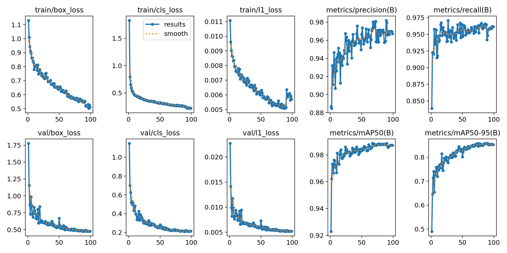

# Training report

| Setting | Value |
|---|---|
| Base model | `yolo26s.pt` (COCO-pretrained YOLO26-S) |
| Hardware | Kaggle Tesla T4 |
| Ultralytics | 8.4.198 |
| Image size | 640 |
| Batch | 16 |
| Epochs (max) | 100, patience 25 |
| LR schedule | cosine |
| Augmentation | Ultralytics defaults + vertical flip 0.5, rotation ±10.0° |
| Wall time | 29.4 min (incl. setup and evaluation) |

Early stopping ended training after 99 of 100 epochs (patience 25). The best validation mAP50-95 was **0.858** at epoch
74 (mAP50 0.987); those weights (`best.pt`) are used for evaluation.
The final epoch reached mAP50-95 0.853.

## Progress

| Epoch | Train box | Train cls | Val box | Val cls | mAP50 | mAP50-95 |
|---|---:|---:|---:|---:|---:|---:|
| 1 | 1.131 | 1.829 | 1.778 | 1.148 | 0.923 | 0.490 |
| 10 | 0.779 | 0.454 | 0.832 | 0.481 | 0.967 | 0.720 |
| 20 | 0.755 | 0.400 | 0.610 | 0.343 | 0.978 | 0.777 |
| 30 | 0.721 | 0.359 | 0.588 | 0.290 | 0.982 | 0.801 |
| 40 | 0.679 | 0.347 | 0.560 | 0.283 | 0.982 | 0.826 |
| 50 | 0.651 | 0.321 | 0.668 | 0.283 | 0.983 | 0.801 |
| 60 | 0.624 | 0.301 | 0.539 | 0.246 | 0.983 | 0.838 |
| 70 | 0.575 | 0.281 | 0.503 | 0.227 | 0.987 | 0.850 |
| 80 | 0.555 | 0.262 | 0.480 | 0.221 | 0.988 | 0.853 |
| 90 | 0.546 | 0.254 | 0.480 | 0.213 | 0.989 | 0.858 |
| 99 | 0.511 | 0.222 | 0.476 | 0.215 | 0.987 | 0.853 |

